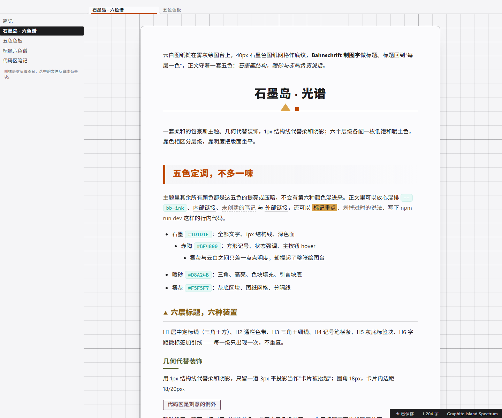
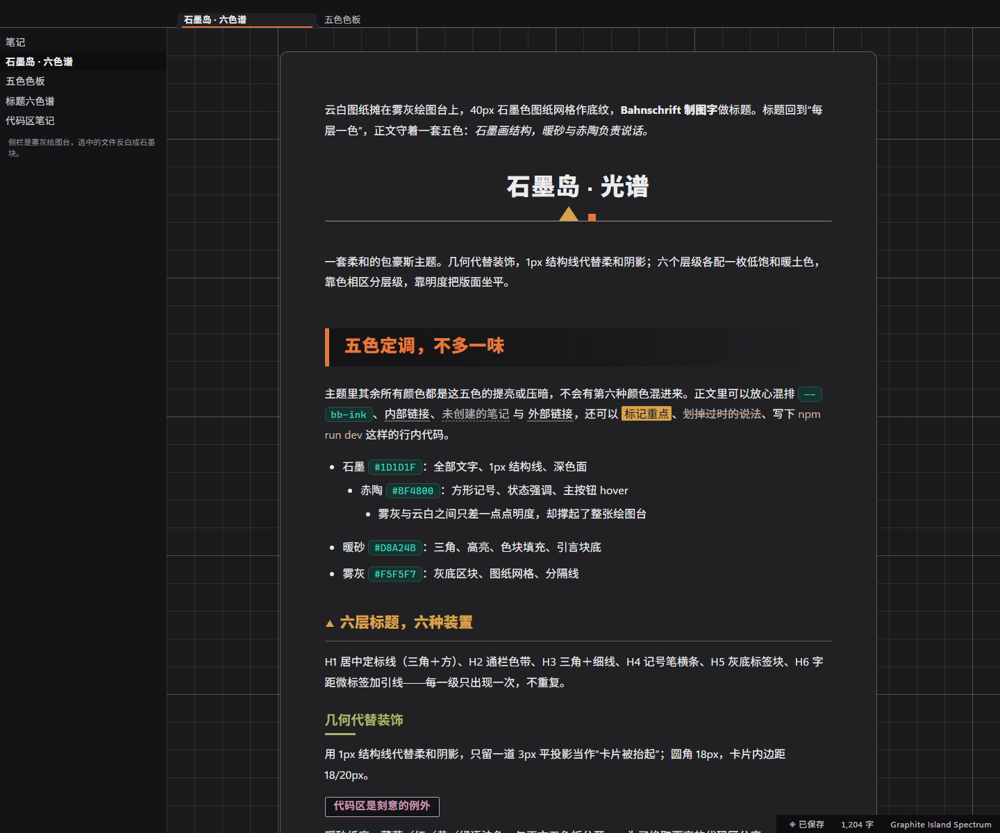

# Graphite Island Spectrum · an Obsidian theme

> The Typora theme of the same name, ported to Obsidian — sheet of paper on a drafting board,
> six warm hues for six heading levels, geometry instead of ornament.
> Light mode is the original palette, colour for colour. Dark mode is a derived
> “graphite night” that keeps the same five colours, the same six tones and the same marks.

Ported from the Typora theme of the same name (MIT, © 2026 Jenlybein).





*Both images are real renders of `theme.css` on top of Obsidian 1.13.7's own `app.css`
(headless Chromium, static DOM) — not mock-ups drawn by hand.*

## Install

1. Copy the `graphite-island-obsidian` folder into your vault's themes folder:
   `<vault>/.obsidian/themes/`.
   (Fastest route in Obsidian: **Settings → Appearance → Themes → Manage → Open themes folder**.)
2. In **Settings → Appearance → Themes**, pick **Graphite Island Spectrum**.
3. Switch between light and dark mode to get both palettes — the theme ships the paper version
   and the graphite-night version.

`manifest.json` and `theme.css` are the only files Obsidian needs; `README.md`, `README_CN.md` and
`LICENSE` are for humans.

## What came across unchanged

| Typora | Obsidian | Notes |
| --- | --- | --- |
| `#write` paper sheet on a grey drafting board | `.markdown-preview-sizer` (reading) and `.cm-sizer` (live preview) | 860px sheet, 1px ink border, 12px radius, sheet shadow; the board behind it is `--file-margins` + the grid |
| 40px drafting grid, 200px major line | `.markdown-preview-view`, `.cm-scroller` | printed, `background-attachment: fixed`, so text scrolls over the board |
| H1 centred + triangle/square calibration line | `h1` / `.HyperMD-header-1` / `.inline-title` | the mark is a `background-image` layer, not `::after` |
| H2 clay band with 6px rule | `h2` / `.HyperMD-header-2` | mist gradient, fades to the right |
| H3 ochre triangle + 1px rule | `h3` / `.HyperMD-header-3` | triangle is an inline SVG background |
| H4 olive 44px marker bar | `h4` / `.HyperMD-header-4` | 3px underline, first 44px solid |
| H5 plum “sticker” block | `h5` / `.HyperMD-header-5` | `width: fit-content` block, mist fill, plum outline |
| H6 letterspaced small caps + lead-in tick | `h6` / `.HyperMD-header-6` | 26px tick, `text-transform: uppercase` |
| amber blockquote, mist nested blockquote | `blockquote` / `.HyperMD-quote` | quote text keeps the ink colour; headings inside fall back to ink |
| mint inline-code chip, warm-paper fenced card | `code` / `pre` and `.cm-inline-code` / `HyperMD-codeblock-bg` | 18px radius, 2px sand border, 3px flat shadow |
| graphite table header, mist zebra, amber hover | `--table-*` | header is `--bb-invert-bg` so it stays a *dark* band in dark mode |
| square task checkbox | `--checkbox-*` | Obsidian draws the tick with a mask, so the square comes from `--checkbox-radius: 2px` |
| graphite footer, paper text | `.status-bar` | |
| mist sidebar, ink selected row | `.nav-file-title`, `.tree-item-self` | |
| print strips grid, borders, radii, shadows | `@media print` | also hides chrome, forces white paper |

## What is new (Obsidian has surfaces Typora does not)

Properties panel, callouts, tabs and tab bar, ribbon, command palette and menus, modals,
notices and tooltips, embeds, Canvas and graph colours, scrollbars, focus rings.
They all use the same five colours; callouts use the six heading tones, so no new hue appears.

## Dark mode: graphite night

Not an inverted filter — the roles were re-derived so the design survives a dark ground
(every number below is measured, WCAG 2.x, alpha-composited):

| | light | dark |
| --- | --- | --- |
| sheet | `#FBFBFD` | `#212124` |
| drawing board | `#F5F5F7` | `#1B1B1E` |
| recessed panels / grey blocks | `#F5F5F7` | `#141416` |
| inverted blocks (table header, status bar, selected row) | `#1D1D1F` | `#0E0E10` |
| body text | `#1D1D1F` — 16.28:1 | `#ECECEF` — 13.62:1 |
| H2 clay | `#BF4800` — 4.91:1 | `#E1793C` — 5.35:1 |
| blockquote ground | solid `#D8A24B` | amber at 28% over the sheet |
| primary button | ink fill, paper text | amber fill, `#1B1B1E` text (a `#0E0E10` fill on the sheet is only 1.40:1 — it would read as a hole) |
| code card | `#efe9d6` | `#302B23` (same “warm paper pasted on the sheet” register, 1.14:1 vs 1.17:1) |

The six heading hues keep their hue angles and only move in lightness, into the same
L 62–78% band the light version uses at L 28–40%.

## Deliberate deviations from the Typora file

1. **No `::before` / `::after` for heading marks.** Typora's decorations are pseudo-elements;
   inside CodeMirror 6 those sit in the editable line and can disturb caret placement. Every mark
   is drawn with `background-image`, `border` or `padding` instead, so reading view and live preview
   share one technique. Cost: on a *wrapped* heading the H3 triangle and the H6 tick sit against the
   middle of the block rather than the first line.
2. **Source mode became the same editor.** Typora has a separate `#typora-source` CodeMirror
   surface (~110 lines of rules); Obsidian's source mode *is* the live-preview editor, so those
   rules have no counterpart. The formatting marks (`**`, `#`, `` ` ``) still get the mint tint.
3. **Table stripes switched rows.** Obsidian stripes odd `<tr>`s via `--table-row-alt-background`;
   the Typora version striped even ones. Visually identical, and now it is variable-driven.
4. **Comments are a shade darker** than the original line-number tone (`#a2947c`, not `#c4b89e`),
   because in Obsidian comments are body text, not gutters.
5. **The light code palette keeps the source hues**, which do not reach 4.5:1 on `#efe9d6`
   (worst: comments at 1.62:1). That was the Typora theme's stated trade — colour separation over
   contrast — so it is preserved. If you prefer AA, uncomment the repair overlay at the end of
   `theme.css`: same hues, 9 brightness-only changes, all pairs ≥ 4.5:1. The dark palette already
   meets AA everywhere.
6. **Live-preview blockquotes are assembled line by line.** CSS cannot merge a run of sibling
   CodeMirror lines into one card, so in live preview a quote is a run of full-width amber bands
   with a 20px inset; the rounding is faked — the first line rounds its top corners, the last its
   bottom corners, the lines in between stay square (rounding every line would notch the seams).
   Reading view gets the real card.
7. **H5 is shrink-to-fit in both views** (`width: fit-content`). In live preview that leaves the
   remainder of the line clickable but visually empty.
8. **The sheet is 860px wide including its 56/64/96 padding** — the literal `#write max-width` from
   the source. If you read the original as *content*-box (i.e. 860px of text), set
   `--bb-sheet-width: 988px`; that is the only difference between the two readings.
9. **The inline title carries the H1 calibration bar too.** A note whose filename title *and* first
   line are both ``#`` headings will therefore show two bars; drop the `.inline-title` bar (one
   rule) if that bothers you.

## Obsidian surfaces covered beyond the Typora original

Properties panel, callouts, tabs and tab bar, ribbon, command palette and menus, modals, notices and
tooltips, embedded notes plus PDF/audio/video embeds, Canvas and graph colours, Bases (database
views), scrollbars, focus rings, print. They all use the same five colours; callouts use the six
heading tones, so no new hue appears.

## Customise

Everything is driven by tokens at the top of `theme.css`:

```css
body.theme-light {
  --bb-ink:   #1D1D1F;   /* all text and 1px structure */
  --bb-paper: #FBFBFD;   /* sheet and cards */
  --bb-amber: #D8A24B;   /* warm accent */
  --bb-clay:  #BF4800;   /* strong accent */
  --bb-mist:  #F5F5F7;   /* grey panel ground */
}
```

Six heading tones are their own tokens (`--bb-h1` … `--bb-h6`), and the inverted blocks have
their own pair (`--bb-invert-bg` / `--bb-invert-ink`) so you can flatten headings to one colour,
or turn the table header back into a plain band, without touching anything else.
Theme-level overrides can go in a CSS snippet instead of editing this file.

## Verification

The port was written against Obsidian 1.13.7's own `app.css` (extracted from the installed app),
then audited three ways before shipping:

| check | result |
| --- | --- |
| Coverage matrix (94 Typora features → Obsidian DOM) | every row has a rule; the four rows CSS cannot express in live preview are documented above |
| Cascade / specificity audit vs `app.css` | 42 contested properties, all resolved (heading colours, tab underline, LP heading padding, table-cell padding, print tokens …) |
| Contrast audit (WCAG 2.x, alpha-composited) | 232 pairs measured per mode: light body 16.28:1, dark body 13.62:1, lowest heading 4.66:1; the only failing set left is the deliberately-preserved light code palette |
| CSS structure | 227 blocks / 1246 declarations, balanced; no `color-mix`, no `:has`, no external URLs |

## Practical notes

- **No external dependencies.** No `@import`, no web fonts, no remote images; the decorative
  marks are inline `data:` SVGs (one set per mode, so dark mode gets brighter marks).
- **Fonts without installs.** Body prefers `Segoe UI Variable Text` / `Noto Sans SC` / `MiSans` /
  `Microsoft YaHei`; headings prefer `Bahnschrift`; code prefers `JetBrains Mono` / `Cascadia Code` /
  `SF Mono` / `Consolas`. Every stack ends in a system fallback.
- **Built against Obsidian 1.13.7** (its real `app.css` was used as the source of truth for every
  variable and selector). `minAppVersion` is set to 1.5.0; no newer CSS features (`color-mix`,
  `:has`) are required.
- **Print / PDF** strips the grid, the sheet, borders, radii and shadows; only ink stays.
- **Reduced motion** collapses transitions when the system asks for it.

## License

MIT — see [LICENSE](LICENSE). Original Typora theme © 2026 Jenlybein.
