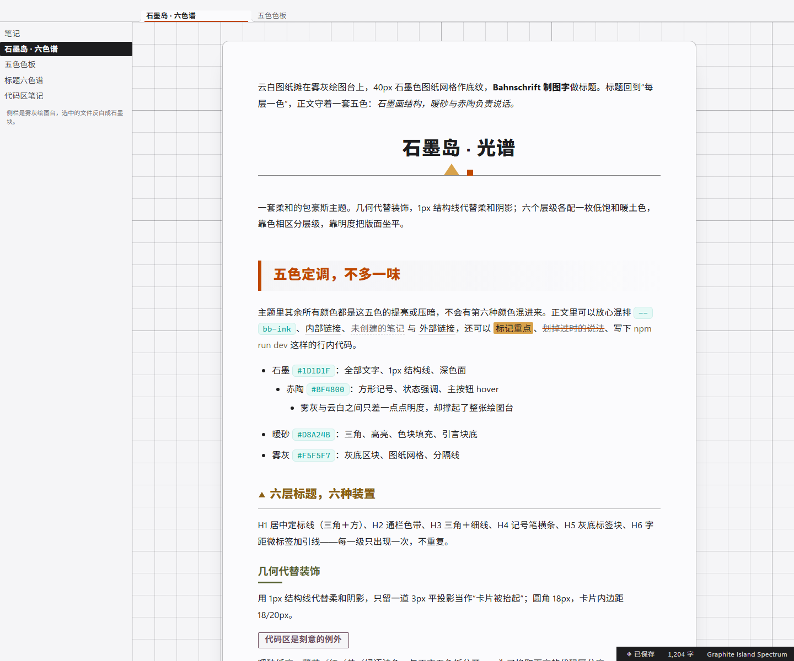
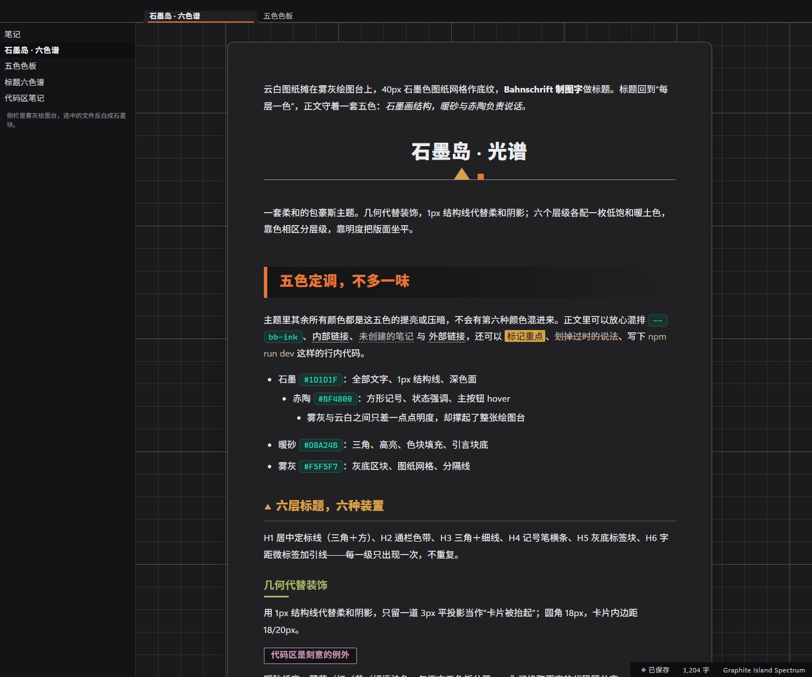

# 石墨岛 · 六色谱 —— Obsidian 主题

> 同名 Typora 主题的 Obsidian 版本：石墨图纸上的暖土六色谱。
> 浅色模式是原主题的配色，一个色值都没改；深色模式是派生的“石墨岛 · 夜”，
> 五色、六色谱与全部几何记号都保留。

移植自同名的 Typora 主题（MIT，© 2026 Jenlybein）。





*两张都是 `theme.css` 叠在 Obsidian 1.13.7 真实 `app.css` 上的渲染结果（无头 Chromium + 静态 DOM），不是手绘的示意图。*

## 安装

1. 把整个 `graphite-island-obsidian` 文件夹放进库的主题目录：`<库名>/.obsidian/themes/`。
   （在 Obsidian 里最快的方式：**设置 → 外观 → 主题 → 管理 → 打开主题文件夹**。）
2. 在 **设置 → 外观 → 主题** 里选 **Graphite Island Spectrum**。
3. 切换浅色/深色模式，就能看到两套调色板：云白图纸版与夜图纸版。

Obsidian 只需要 `manifest.json` 与 `theme.css`，`README` 与 `LICENSE` 是给人看的。

## 原样搬过来的部分

| Typora | Obsidian | 说明 |
| --- | --- | --- |
| `#write` 云白图纸摊在雾灰绘图台上 | `.markdown-preview-sizer`（阅读视图）/ `.cm-sizer`（实时预览） | 860px 纸面、1px 墨线框、12px 圆角、纸面投影；纸外的绘图台由 `--file-margins` + 网格构成 |
| 40px 图纸网格、200px 大格 | `.markdown-preview-view`、`.cm-scroller` | 固定在绘图台上（`background-attachment: fixed`），内容从网格上滑过 |
| H1 居中 + 三角/方形定标线 | `h1` / `.HyperMD-header-1` / `.inline-title` | 记号用 background-image 分层，不用 ::after |
| H2 赤陶色带 + 6px 竖条 | `h2` / `.HyperMD-header-2` | 雾灰渐变向右淡出 |
| H3 赭金三角 + 1px 线 | `h3` / `.HyperMD-header-3` | 三角是内联 SVG 背景 |
| H4 橄榄 44px 记号笔横条 | `h4` / `.HyperMD-header-4` | 3px 下划线，前 44px 实心 |
| H5 梅褐“贴纸”标签块 | `h5` / `.HyperMD-header-5` | `width: fit-content` 块，雾灰底 + 梅褐描边 |
| H6 字距小标签 + 26px 引线 | `h6` / `.HyperMD-header-6` | `text-transform: uppercase` |
| 暖砂引言块、嵌套引言落回雾灰 | `blockquote` / `.HyperMD-quote` | 块内文字保持墨色，彩色标题一律回墨 |
| 薄荷行内代码 / 暖纸代码卡片 | `code` / `pre`，`.cm-inline-code` / `HyperMD-codeblock-bg` | 18px 圆角、2px 浅砂边、3px 平投影、每行底部 1px 信纸线 |
| 墨底云白字表头 + 雾灰斑马 + 暖砂 hover | `--table-*` | 表头用 `--bb-invert-bg`，所以深色模式下仍是“深色带”而不是白带 |
| 方形任务复选框 | `--checkbox-*` | Obsidian 的勾是 mask 图，方形只能靠 `--checkbox-radius: 2px` |
| 整条石墨页脚 | `.status-bar` | |
| 雾灰侧栏 + 墨色选中行 | `.nav-file-title`、`.tree-item-self` | |
| 打印去掉网格、边框、圆角、投影 | `@media print` | 同时隐藏外壳，强制白纸 |

## 新增的部分（Typora 没有对应物）

属性面板、callout、标签页与标签栏、丝带、命令面板与菜单、模态框、提示条、嵌入笔记、
Canvas 与图谱配色、滚动条、焦点环。全部落在同一套五色里；callout 用六色谱本身，不引入新色相。

## 深色模式：石墨岛 · 夜

不是简单反色，而是把“角色”重新推导，让设计在暗底上仍然成立（以下数值都是实测的 WCAG 2.x 对比度，
半透明色已做合成）：

| | 浅色 | 深色 |
| --- | --- | --- |
| 纸面 | `#FBFBFD` | `#212124` |
| 绘图台 | `#F5F5F7` | `#1B1B1E` |
| 退后的灰面 / 灰区块 | `#F5F5F7` | `#141416` |
| 反白块（表头 / 状态栏 / 选中行） | `#1D1D1F` | `#0E0E10` |
| 正文 | `#1D1D1F` — 16.28:1 | `#ECECEF` — 13.62:1 |
| H2 赤陶 | `#BF4800` — 4.91:1 | `#E1793C` — 5.35:1 |
| 引言块底 | 暖砂实心 `#D8A24B` | 暖砂 28% 压在纸面上 |
| 主按钮 | 石墨底 + 云白字 | 暖砂底 + `#1B1B1E` 字（`#0E0E10` 贴在夜纸上只有 1.40:1，会像个洞） |
| 代码卡片 | `#efe9d6` | `#302B23`（同样是“暖纸贴在纸面上”，1.14:1 对应浅色的 1.17:1） |
| 文字选中 | 石墨洗染 22%（纸面 10.3:1、引言块 5.0:1） | 云白洗染 22% |

六个标题色只改明度不改色相，统一收在 L62–78%，对应浅色版的 L28–40%。

## 与原文件不同的地方（刻意为之）

1. **标题记号不用 `::before` / `::after`。** Typora 用伪元素画记号；在 CodeMirror 6 里伪元素
   长在可编辑行内部，会干扰光标落位。这里一律用 `background-image` / `border` / `padding` 实现，
   阅读视图与实时预览共用同一套画法。代价：标题**换行时**，H3 的三角与 H6 的引线会贴在整段
   中线，而不是首行。
2. **源码模式没有独立样式了。** Typora 的 `#typora-source` 是另一块 CodeMirror（约 110 行规则）；
   Obsidian 的源码模式就是实时预览编辑器本身，那些规则没有对应物。格式符（`**`、`#`、`` ` ``）
   仍保留薄荷色的轻描。
3. **表格斑马换了行序。** Obsidian 用 `--table-row-alt-background` 给奇数行上底色，Typora 版给偶数行上色；
   视觉等价，但现在由变量驱动。
4. **注释比原来深一档**（`#a2947c`，不是行号色 `#c4b89e`）——在 Obsidian 里注释是正文，不是行号槽。
5. **浅色代码区保留源色**，在 `#efe9d6` 暖纸上达不到 4.5:1（最差是注释 1.62:1）。这是 Typora 版的
   既定取舍（区分度优先于对比度），所以原样保留。若你更看重可读性，把 `theme.css` 末尾的
   “AA 修复覆盖层”取消注释即可：色相不变、只动 9 处明度，全部 ≥ 4.5:1。深色代码区本身已全部达标。
6. **引言块是方角，不是圆角。** 实时预览的引言是一串兄弟行盒，CSS 合不成一张卡片：
   逐行圆角会在每条行缝两端留下小楔子，而"只圆首末行"必须用 `:has()`（失效范围大、拖累编辑器）。
   与其留个半吊子圆角，不如方角——色带连续、接缝干净，也与本主题 1px 结构线的直角语言一致。
   阅读视图同样保持方角，两种模式形状统一。
7. **H5 是收缩包装的贴纸**（`width: fit-content`）：实时预览里贴纸右侧那段行内区域依然可点击，
   只是视觉上是空的。
8. **纸面宽 860px，含 56/64/96 的内边距**——取源文件 `#write max-width` 的字面值。
   如果你认为原版按 content-box 计算（即 860px 的文字宽度），把 `--bb-sheet-width` 改成 `988px`
   即可，这是两种读法唯一的差别。
9. **行内标题也带 H1 的定标线。** 如果一篇笔记既显示文件名标题、正文第一行又是 `#` 标题，
   就会出现两条定标线；不想要的话删掉 `.inline-title` 那一条规则即可。

## 除 Typora 原版之外补上的 Obsidian 面板

属性面板、callout、标签页与标签栏、丝带、命令面板与菜单、模态框、提示条、嵌入笔记与
PDF/音视频嵌入、Canvas 与图谱配色、Bases 数据库视图、滚动条、焦点环、打印。
它们全部只使用同一套五色；callout 用六色谱本身，不引入新的色相。

## 自定义

所有颜色都是 `theme.css` 顶部的令牌：

```css
body.theme-light {
  --bb-ink:   #1D1D1F;   /* 全部文字与 1px 结构线 */
  --bb-paper: #FBFBFD;   /* 纸面与卡片 */
  --bb-amber: #D8A24B;   /* 暖色口音 */
  --bb-clay:  #BF4800;   /* 强口音 */
  --bb-mist:  #F5F5F7;   /* 灰面底 */
}
```

六色谱是六个独立令牌（`--bb-h1` … `--bb-h6`），反白块另有
`--bb-invert-bg` / `--bb-invert-ink` 一对——想把标题压成同一色、或把表头改回普通色带，
都不用动别的地方。临时改动建议写成 CSS 片段，而不是直接改这个文件。

## 验证过程

这版是照着 Obsidian 1.13.7 自己那份 `app.css`（从安装目录里抽出来的）写的，出货前做了三轮审计：

| 检查 | 结果 |
| --- | --- |
| 覆盖矩阵（94 条 Typora 特性 → Obsidian DOM） | 每一条都有对应规则；CSS 无法在实时预览里表达的四条已在上面写明 |
| 层叠/权重审计（对照 `app.css`） | 42 处争用全部落地（标题颜色、标签下划线、实时预览标题内边距、表格单元格内边距、打印令牌……） |
| 对比度审计（WCAG 2.x，半透明已合成） | 两种模式各实测 232 对：浅色正文 16.28:1，深色正文 13.62:1，最低的标题 4.66:1；唯一仍然不达标的只有刻意保留的浅色代码子色板 |
| CSS 结构 | 227 个规则块 / 1246 条声明，括号平衡，没有 `color-mix`/`:has`，没有外部资源 |

## 实用说明

- **零外部依赖。** 没有 `@import`、没有网络字体、没有远程图片；装饰记号是内联 `data:` SVG
  （两套模式各一份，所以夜里的记号更亮）。
- **无需安装字体。** 正文优先 `Segoe UI Variable Text` / `Noto Sans SC` / `MiSans` / `Microsoft YaHei`；
  标题优先 `Bahnschrift`；代码优先 `JetBrains Mono` / `Cascadia Code` / `SF Mono` / `Consolas`。
  每套字体栈都以系统字体兜底。
- **按 Obsidian 1.13.7 的真实 `app.css` 写的**——每个变量与选择器都对着它核对过；
  `minAppVersion` 设为 1.5.0，没有用到 `color-mix`、`:has` 之类的新特性。
- **打印 / PDF** 去掉网格、纸面、边框、圆角与投影，只留墨。
- **减少动态效果** 在系统开启该设置时压缩所有过渡。

## 许可证

MIT —— 见 [LICENSE](LICENSE)。原 Typora 主题 © 2026 Jenlybein。
